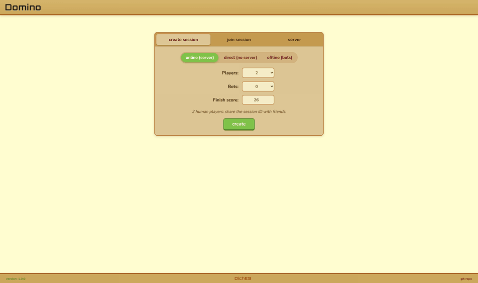
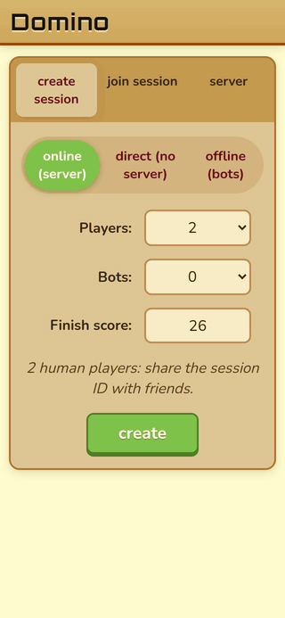
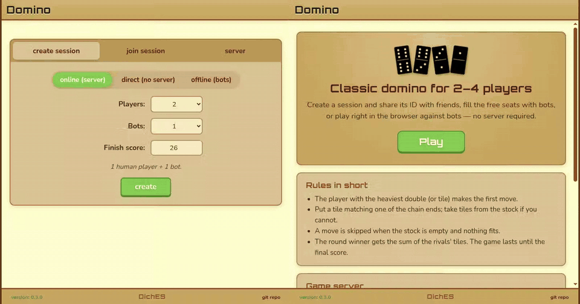

# Domino

<p align="center">
  <a href="https://andrew1407.github.io/Domino/">
    
  </a>
</p>

<a href="https://github.com/Andrew1407/Domino/actions/workflows/main.yml"></a>
<a href="https://github.com/Andrew1407/Domino/actions/workflows/pages.yml"></a>

Classic domino for 2-4 players: online sessions over a WebSocket API, bot players, serverless direct (peer-to-peer) games, and an in-browser offline mode.

Design document is **[here](./design-doc/index.md)**.

**[Game API](./server)**: HTTP & WS servers (NestJS 12, Redis).

**[Browser client](./client)**: Next.js 16 client, also deployable as a static site (GitHub Pages showcase).

## Demo

A game against three bots: creating the session, picking tiles, the drop targets on the board, zoom and the result.

<p align="center">
  
</p>

On a phone: the chain wraps to the narrow board, pinch to zoom.

<p align="center">
  
</p>

Direct mode, no server: the host (left) sends an invite link, the guest (right) answers with a reply code and the game starts over WebRTC.

<p align="center">
  
</p>

## Features

- sessions for 2-4 players, joined by session ID or invite link;
- bots: any number of seats (up to `players - 1`) can be taken by bots, e.g. 1 human + 3 bots, 2 humans + 1 bot, 3 humans + 1 bot.
  The bot tactic is the simplest one: put the first tile that fits, otherwise take a tile from the stock, otherwise skip;
- offline mode: the whole game runs in the browser against bots, with no server needed;
- direct mode: one browser hosts the game (with optional bots) and other players connect to it over WebRTC.
  Invites are exchanged by hand (a link one way, a reply code back), so no game or signalling server is used.
  It works on the same Wi-Fi or phone hotspot, even without internet; public STUN servers can be enabled in the
  **server** tab to connect across networks. The host page must stay open, since it runs the game;
- server selection: the client talks to the local server API (`localhost:8080` / `localhost:8081`) by default,
  and any other server can be set in the UI (*Server* tab or the home page).

## Run with Docker

```bash
docker compose --env-file ./.env.example up --build
```

The client is served at `http://localhost:3000`, the API at `http://localhost:8080` (HTTP) and `ws://localhost:8081` (WS).

**Server tests in containers (the same command CI runs):**
```bash
docker compose -f docker-compose.test.yaml --env-file ./.env.example up --build --exit-code-from server_test
```
